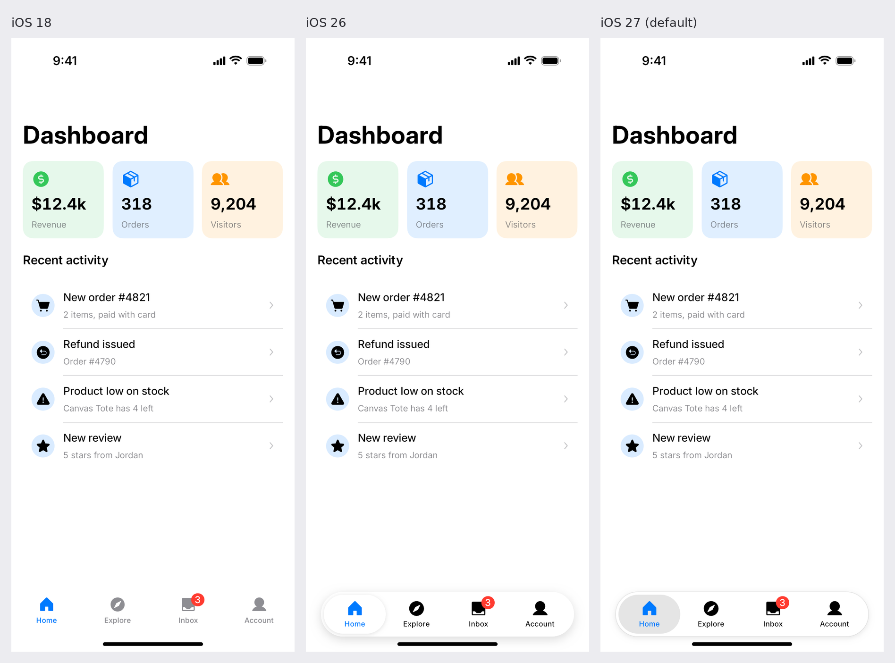

# swiftui-screenshot

Renders SwiftUI source code to a PNG on Linux or a Mac. No simulator, no Xcode project, no browser.

```
swiftui-screenshot render Examples/Hello.swift -o shot.png
```


Every image above was produced on Linux from the unmodified SwiftUI files in
[`Tests/Corpus/`](Tests/Corpus), at the default look (iOS 27) with the bundled open fonts.

It exists so that a coding agent, a CI job or a person without a Mac can see what a SwiftUI screen
looks like after changing it, in light and dark, on different devices and text sizes, and can get
the accessibility structure of the screen as data.

## How it works

Apple's SwiftUI is closed-source and only runs on Apple platforms, so this project is a
reimplementation: a Swift module **named `SwiftUI`** that your code compiles against
unchanged, with its own layout engine, text engine and rasterizer.

1. Your sources are rewritten slightly (`#Preview` becomes a registered entry, `@main` is
   dropped, `#if os(...)` branches are kept for the rendered platform).
2. They are compiled with the regular Swift toolchain against this module.
3. The resulting program resolves the view tree, lays it out with SwiftUI's
   propose/size/place protocol, draws it with Skia, and writes a PNG.

A cold render takes about a second including compilation; repeat renders of the same
sources are cached and take about half that. See [docs/ARCHITECTURE.md](docs/ARCHITECTURE.md).

## Quick start

Build from source (see [Install](#install) for the other routes):

```
scripts/bootstrap.sh
swift build
BIN="$(swift build --show-bin-path)/swiftui-screenshot"
$BIN doctor
$BIN render Examples/Hello.swift -o shot.png
```

`doctor` checks the Swift toolchain, the fonts and the module; it exits non-zero when something is missing.
`render` prints the output path and its pixel size, and one `warning:` line for anything that is not drawn
faithfully (an unmapped SF Symbol, a missing asset, a UIKit view).

What gets rendered, first match wins: `--view "ContentView()"`, a `#Preview` (pick with
`--preview <index|name>`, or `--all`), a `PreviewProvider`, or the first `WindowGroup` of an
`@main App`. Pass a directory to render a multi-file module.

```
swiftui-screenshot list Tests/Corpus/01_Settings.swift
swiftui-screenshot render Tests/Corpus/12_ComponentGallery.swift --all --scheme both --out-dir out
swiftui-screenshot render Examples/Hello.swift --view 'Text("Hi").padding()' --layout fit
```

## Commands and options

```
swiftui-screenshot render <file-or-dir>... [options]
swiftui-screenshot list <file-or-dir>...          # previews found in the sources
swiftui-screenshot devices
swiftui-screenshot compare <reference> <candidate> [options]
swiftui-screenshot doctor
swiftui-screenshot version
```

| Option | Meaning |
|---|---|
| `-o file.png`, `--out-dir dir` | Where to write. Default is `<first-source-name>.png`; `--out-dir` is required when several images are produced. |
| `--scheme light\|dark\|both` | Appearance. |
| `--ios 18\|26\|27\|latest` | Which iOS design to draw. Default `latest` (27, Liquid Glass). 26 is the first Liquid Glass; 18 is the flat, pre-glass look. |
| `--device iphone-16` | Screen size, scale, safe areas and status bar of a device. Names are forgiving (`iphone-16-pro`, `"iPhone 16 Pro"`, `iphone16pro`). See `devices`. |
| `--orientation portrait\|landscape` | Also `landscape-left` / `landscape-right`. Swaps the size and uses landscape insets; iPhones hide the status bar. `#Preview(traits: .landscapeLeft / .sizeThatFitsLayout / .fixedLayout(...))` set the defaults per preview; flags override them. |
| `--crop <part>` | Only one part of the screen, at the device's scale and with no device chrome around it: a view's `.accessibilityIdentifier` (containers too), an element's label, or `x,y,w,h` in points. `--crop-padding <pt>` keeps a margin. To render a component on its own instead, use `--view "MyCard()" --layout fit`. |
| `--rounded-corners` | Clip to the device's rounded display, corners transparent. |
| `--show-island` | Draw the Dynamic Island or notch on top (simulator screenshots do not show it). |
| `--frame` | Draw the device around the screen: glass border, band, side buttons, Dynamic Island or notch. See [Device frames](#device-frames). |
| `--frame-dir <dir>` | Use your own frame image, `<dir>/<device-id>.png`, instead of the generic one. |
| `--platform ios\|tvos\|watchos` | Platform to compile for and draw. Decides which `#if os(...)` branches build. Implied by `--device apple-tv-*` and `apple-watch-*`. |
| `--layout device\|fit\|fixed` | Full screen with status bar (default); just the view's own size; or an exact `--width` / `--height`. `--padding <pt>` adds a margin in `fit`. |
| `--width <pt>`, `--height <pt>` | Canvas size (`fixed`), or the size proposed to the view (`fit`). |
| `--scale <n>` | Pixels per point. Default: the device's. |
| `--background <hex\|clear>` | Background colour, or transparent. |
| `--no-chrome` | Omit the status bar and home indicator. |
| `--dynamic-type xxxLarge` | `xSmall` to `xxxLarge`, `accessibility1` to `accessibility5`. |
| `--assets dir`, `--fonts dir` | Images and `.xcassets` catalogs; extra fonts searched first. Directories you pass as sources are searched for assets automatically. |
| `--open-fonts` | Use the bundled open fonts even when Apple's are installed. |
| `--task-timeout <s>` | Real seconds `.task` closures may run before the frame is taken (default 0.5; `--task-budget` is the old name). |
| `--settle-time <s>` | Virtual seconds that pass before the frame is taken (default 2): `Task.sleep` runs on a virtual clock, so a sleep that ends within them returns at once and one that ends later waits past the frame. |
| `--time-zone <tz>` | The device's time zone, an IANA name such as `Europe/Brussels` (default `UTC`, whatever the host's): `TimeZone.current`, `Date.formatted`, `Text(date, style:)` and the date pickers use it. |
| `--locale <id>` | The device's language and region, such as `nl_BE` (default `en_US`): number, currency and date formats, and in project mode the string catalogs' language. `Text` follows it on every host; `Locale.current` in your own code follows it on macOS. |
| `--location <lat>,<lon>` | The device's position: location access is granted and `CLLocationManager` and `CLLocationUpdate.liveUpdates()` report it (default: access not determined, no position, as on a fresh install). |
| `--date <ISO 8601>` | "Now" for `TimelineView` and interaction captures, such as `2026-06-01T09:41:00Z` (default: the real time; `Date()` in your own code always is). |
| `--allow-network` | Let the code reach the network, so remote images (`AsyncImage` and an app's own loaders) and API calls load while the frame settles; raise `--task-timeout` for slow servers. By default a render is offline: requests fail at once with `URLError(.notConnectedToInternet)`. |
| `--map-tiles <dir>` | Draw `Map`s on your own offline raster tiles, `<dir>/<z>/<x>/<y>.png` in the usual web map layout, instead of a plain surface. No tiles are bundled; their licence and attribution are yours to follow. See [docs/MAPS.md](docs/MAPS.md#offline-tiles). |
| `--accessibility-tree f.json`, `--tap-targets f.png`, `--accessibility-outline` | Accessibility outputs, below. |
| `--json` | One JSON object per image with path, size and warnings. |
| `--no-cache`, `-v` | Recompile even if an identical build is cached; show the compiler command. |

## Outputs

The default output is one PNG per (preview, scheme). For agents and CI that want structure rather than pixels:

```
swiftui-screenshot render Examples/Accessibility.swift --accessibility-tree a11y.json --tap-targets taps.png --accessibility-outline
```

- `--accessibility-tree <file.json>`: the tree VoiceOver would see (approximately), with frames in points, tap-target
  data and an `issues` array: `smallTarget` (under 44x44pt), `missingLabel`, `imageMissingLabel`,
  `duplicateIdentifier`, `overlappingTargets`, `truncatedText`.
- `--tap-targets <file.png>`: the screenshot dimmed, every interactive element's hit rect outlined, green when
  both sides are at least 44pt and red otherwise.
- `--accessibility-outline`: the tree as indented text on stdout, such as `button "Follow" (16,360 170x38)`.

The PNG is byte-identical with or without these flags. Schema and details: [docs/REFERENCE.md](docs/REFERENCE.md).
[`Examples/Accessibility.swift`](Examples/Accessibility.swift) contains one of each problem.

### Comparing against references

`compare` closes a calibration loop: screenshots captured from the iOS Simulator are compared with this tool's
renders. On a Mac, capture and comparison run on the same machine.

```
swiftui-screenshot compare reference.png candidate.png --out-dir cmp
swiftui-screenshot compare references/ renders/ --baseline scores.json --update-baseline
swiftui-screenshot compare references/ renders/ --baseline scores.json --fail-on-regression
```

It takes two PNGs or two directories (matched by relative file name), does a perceptual pixel diff that ignores
anti-aliasing, detects vertical and horizontal shifts ("rows 261 to 839pt are 2pt higher in the candidate"), writes
a heatmap and a `reference | candidate | heatmap` composite, can match element frames from accessibility trees,
and can store and check per-image scores as a baseline. Options and the report format: [docs/REFERENCE.md](docs/REFERENCE.md).

## Fonts and symbols

- **Open fonts, bundled.** `scripts/bootstrap.sh` fetches Inter (for SF Pro), Nunito (SF Rounded), Source Serif 4
  (New York), JetBrains Mono (SF Mono) and Noto Color Emoji. When Apple's fonts are absent, Inter is laid out with
  SF Pro's advance widths, so line breaks match SF to about 1%. Glyph shapes still differ.
- **Apple's fonts, opt-in.** SF Pro, SF Pro Rounded, SF Mono and New York are downloaded from Apple, never
  redistributed by this project:

  ```
  scripts/fetch-apple-fonts.sh --accept-apple-font-license
  ```

  Passing the flag states that you accept Apple's font licence (terms: https://developer.apple.com/fonts/;
  it permits creating mock-ups of user interfaces for software on Apple platforms). Needs `7z`
  (`apt-get install 7zip`). They are used automatically afterwards; `doctor` reports which font is in use.
  `--open-fonts` forces the substitutes, `--fonts dir` adds your own.
- **SF Symbols.** By default, about 2,200 names are drawn from Phosphor Icons as stand-ins. Names without a
  stand-in render as a dashed placeholder and are reported as warnings. With Apple's fonts installed and an
  `sf-symbols-map.json` next to them (generated on a Mac; see
  [issue #2](https://github.com/Sam-Apostel/swift-ui-screenshot/issues/2)), real SF Symbols are drawn.

## Platforms and devices

`swiftui-screenshot devices` lists every profile with its size, scale, cutout and safe area: iPhone SE and 11
through the 17 family, 16e and Air; the foldable iPhone Duo closed (`iphone-duo`, its cover display), open
(`iphone-duo-open`, the inner display, landscape-shaped when held upright) and half open (`iphone-duo-half-open`); iPad, mini, Air and Pro in 11 and 13
inch; Apple TV 4K and HD; Apple Watch Series 10 in 46 and 42mm and Ultra 2. The default is
`iphone-16`. Portrait and landscape both work, with the Dynamic Island or notch (`--show-island`) and rounded
display corners (`--rounded-corners`) optional.



`--ios` selects the design: 27 (default) and 26 draw Liquid Glass bars, tab bars and controls, 18 draws the flat
look. The glass geometry is estimated from public material, not measured against a device.

**tvOS (early support).** `--platform tvos` or any `--device apple-tv-*` renders at 1920x1080 points and compiles
the `#if os(tvOS)` branches of your code. Control styling and a focus engine for tvOS are still in progress, so
controls currently look like their iOS counterparts.

**watchOS.** `--platform watchos` or any `--device apple-watch-*` (`apple-watch` is the Series 10 46mm) compiles
the `#if os(watchOS)` branches and draws the watchOS 26 look, measured on the watchOS 26.5 simulator: always dark
(a watch has no light appearance, so `--scheme light` draws dark too), the time in the top corner, the watch's
safe areas and text sizes in SF Compact (when Apple's fonts are installed), capsule buttons, lists of separate
rounded rows under a grey title, and `.verticalPage` dots in the top corner. watchOS's small UIKit (`UIImage`,
`UIColor`, `UIFont`) is visible to files that import SwiftUI, as on the watch. Toolbar items, the back button and
search are not drawn yet. See `Examples/Watch.swift` and `Examples/WatchList.swift`.

### Device frames

`--frame` puts the hardware around the screenshot, for App Store and marketing images:

```
swiftui-screenshot render ContentView.swift --device iphone-17-pro --frame --scheme both --out-dir framed
```

Apple's bezel artwork cannot be redistributed, so the frame is drawn from the device profile: the display's
corner radius, a black glass border, a graphite band, the side buttons (and Camera Control where the model has
it) and the Dynamic Island or notch. It covers every iPhone, the iPads, the Apple Watch sizes (case, Digital
Crown and a strap fading out) and Apple TV (a plain bezel). Proportions come from the published body and screen
sizes; they are close, not exact. Landscape renders turn the device. Around the device the image is
transparent.

To use artwork you are licensed to use instead, pass
`--frame-dir <dir>`. For each render it reads `<dir>/<device-id>.png` (the ids `devices` lists), and for
landscape `<device-id>-landscape.png` when there is one, otherwise the portrait image turned. The screen is the
transparent region at the centre of the image: the render is scaled into that region's bounding box and the
image drawn on top, so the frame's own rounded corners mask the screen. A device without an image gets the
generic frame and a warning.

The frame applies to every image of an [interaction capture](docs/INTERACTION.md): `--frames`, `--animated` and
the cells of `--filmstrip`. `--full-content` images stay unframed (with a warning), as do `--tap-targets` and the
focus overlays. With `--layout fit` or `fixed` there is no device to frame: a warning, and no frame.


## What is supported

- **Layout**: stacks, frames, padding, alignment guides, `Spacer`, `GeometryReader`, safe area, `ScrollView`,
  lazy stacks and grids, `Grid`, `ViewThatFits`, custom `Layout`s.
- **Drawing**: shapes with continuous corners, gradients, materials, shadows, blur, masks, blend modes,
  transforms, `Canvas`, `glassEffect`.
- **Text**: wrapping, truncation, Markdown and interpolation in literals, all font designs and weights,
  Dynamic Type, emoji.
- **Controls**: `Button` and its styles, `Toggle`, `Slider`, `Stepper`, `Picker`, `TextField`, `DatePicker`,
  `ProgressView`, `Gauge`, `Label`, `Menu`, and more.
- **System chrome**: `NavigationStack` (large and inline titles, toolbars, search), `TabView`,
  `NavigationSplitView`, `List`/`Form`/`Section`, sheets, alerts, confirmation dialogs, in the look selected by `--ios`.
- **State**: `@State`, `@Binding`, `@Observable`, `ObservableObject`/`@Published`, `@Environment`,
  `@AppStorage`, preferences. `onAppear` and `.task` run before the frame is taken, so views show their loaded state.
- Gestures, animations, transitions and focus APIs compile and are ignored. Accessibility modifiers feed the
  accessibility outputs and never change the picture.

## Install

The tool compiles your sources at render time, so it needs a Swift toolchain of the exact version it was built
with (currently 6.4.2; `swiftui-screenshot version` and `doctor` say which).

**From a release, once a release is published** (Ubuntu 24.04, x86_64 or arm64). No release exists yet and the
repository is private, so this line does not work today:

```
curl -fsSL https://github.com/Sam-Apostel/swift-ui-screenshot/releases/latest/download/install.sh | bash -s -- --claude-instructions
```

`install.sh` installs `libharfbuzz0b` if missing, the pinned Swift toolchain into `/opt/swift` if no matching
`swiftc` is found, unpacks the tarball to `/opt/swiftui-screenshot`, links `/usr/local/bin/swiftui-screenshot`
and runs `doctor`. It is idempotent and quiet on success. Options: `--prefix DIR`, `--version vX.Y.Z`,
`--from <tarball path or URL>`, `--bin-dir DIR`, `--claude-instructions` (adds a short block about the tool to
`~/.claude/CLAUDE.md`), and `--apple-fonts --accept-apple-font-license` (fetches Apple's fonts, see above).

**In a Claude Code cloud environment**, use that line as the setup script (it runs as root; the toolchain
download is about 1 GB, so the first run takes a few minutes), adding `--apple-fonts --accept-apple-font-license`
if you accept Apple's font licence. To tell agents in an app repository how to use the tool, copy
`integrations/claude-skill/swiftui-screenshot` into the repository's `.claude/skills/`.

Releases are built by `.github/workflows/release.yml` when a `v*` tag is pushed. `scripts/make-dist.sh` builds
the same relocatable tarball locally, which `install.sh --from` accepts.

**From source, works today** (Swift 6 toolchain, `libharfbuzz-dev`, `curl`, `unzip`):

```
scripts/bootstrap.sh     # fetches pinned Skia and open fonts into Vendor/ (checksummed)
swift build -c release
"$(swift build -c release --show-bin-path)/swiftui-screenshot" doctor
```

**Docker.** The `Dockerfile` builds the tool on `swift:6.4.2-noble` and keeps the toolchain, since your code is
compiled at render time. Its header comment has the build and run lines.

## macOS

The same engine builds and runs natively on a Mac (Apple silicon or Intel, macOS 15 or later):

```
brew install harfbuzz pkg-config
scripts/bootstrap.sh
swift build -c release
"$(swift build -c release --show-bin-path)/swiftui-screenshot" render Examples/Hello.swift -o shot.png
```

It draws with the same Skia and HarfBuzz code as on Linux, so with `--open-fonts` a render is the same picture
on both. Without it, text is set in the Mac's own SF Pro, SF Pro Rounded, SF Mono, New York and Apple Color
Emoji, with no download. Your code is compiled against this project's SwiftUI and shim frameworks, never Apple's: the tool
gives the compiler a view of the macOS SDK that holds only Foundation and what Foundation is built from, so
`import ARKit` fails and `#if canImport(HealthKit)` is false exactly as on Linux. Combine, os and OSLog are
Apple's own on a Mac. `scripts/make-dist.sh` builds a relocatable tarball there too; it expects Homebrew's
HarfBuzz at run time.

## Limitations

- **It is an approximation.** Output is close to a simulator screenshot, not identical. Spacing constants for
  system components were set from knowledge of iOS, not measured against a device; they live in named constants
  (`ListMetrics`, `NavigationBarMetrics`, ...) so they can be calibrated, and `compare` exists for that.
- **Liquid Glass is estimated.** The geometry, edges and tints of the iOS 26 and 27 looks are reconstructed from
  public material, not measured against a device. The iOS 18 look is the better-calibrated one.
- **Fonts.** Without Apple's fonts the glyph shapes are Inter's, not SF's; line breaks match SF to about 1% but
  not always exactly.
- **SF Symbols** are Phosphor stand-ins unless Apple's fonts and a `sf-symbols-map.json` are installed. They are
  recognisable but not Apple's artwork. Multicolor and hierarchical rendering fall back to a single colour.
- **tvOS focus** follows tvOS 26.5 recordings for all but 18 of 465 moves (docs/FOCUS.md).
- **Interaction is scripted, not live.** Taps, typing and scrolling come from `--steps` (docs/INTERACTION.md).
  Renders are offline by default, so remote images (`AsyncImage`) show their placeholder; `--allow-network` loads them.
- **About 40 Apple frameworks beyond SwiftUI are shimmed** (docs/FRAMEWORKS.md). Others, such as Charts,
  SwiftData and WebKit, are reported as missing; a `UIViewRepresentable` draws a labelled placeholder.
- **API coverage is broad but not complete.** An API this module lacks is a compile error naming it, never a
  silently wrong picture.
- **Left-to-right text only.** iPhone layouts are the best-tested path; iPad profiles and two-column
  `NavigationSplitView` work (see `Examples/SplitView.swift`) but have had less checking.
- **Swift version.** The toolchain must be the exact version the modules were built with.

## Planned

- Device frames around screenshots ([#26](https://github.com/Sam-Apostel/swift-ui-screenshot/issues/26))
- The open items in [docs/ROADMAP.md](docs/ROADMAP.md)

## Licences

The code in this repository is the project's own. It builds on, and `scripts/bootstrap.sh`
downloads, third-party components under their own licences: Skia (BSD-3-Clause, prebuilt
by the SkiaSharp project, MIT), HarfBuzz (MIT), Inter, Nunito, Source Serif 4, JetBrains
Mono and Noto Color Emoji (SIL OFL 1.1), and Phosphor Icons (MIT, artwork compiled into
`Sources/SwiftUI/Symbols`). SwiftUI, SF Pro and SF Symbols are trademarks of Apple Inc.;
this project is not affiliated with Apple and contains no Apple code, fonts or artwork.
Apple's fonts are downloaded only on request, from Apple, under Apple's terms.
