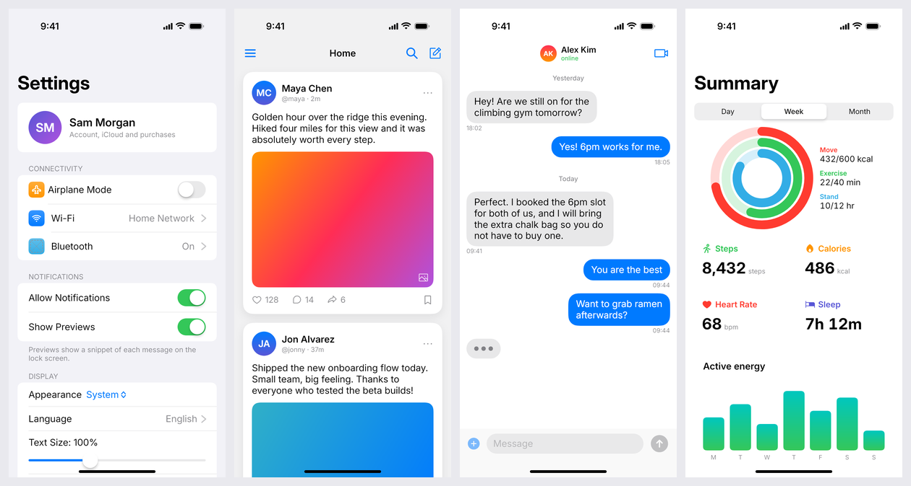

# swiftui-screenshot

Renders SwiftUI source code to a PNG on headless Linux. No macOS, no simulator, no browser.

```
swiftui-screenshot render ContentView.swift -o shot.png
```




Every image above was produced on Linux from the unmodified SwiftUI files in
[`Tests/Corpus/`](Tests/Corpus).

## How it works

Apple's SwiftUI is closed-source and only runs on Apple platforms, so this project is a
reimplementation: a Swift module **named `SwiftUI`** that your code compiles against
unchanged, with its own layout engine, text engine and rasterizer.

1. Your sources are rewritten slightly (`#Preview` becomes a registered entry, `@main` is
   dropped, `#if os(iOS)` branches are kept).
2. They are compiled with the regular Swift toolchain against this module.
3. The resulting program resolves the view tree, lays it out with SwiftUI's
   propose/size/place protocol, draws it with Skia, and writes a PNG.

A cold render takes about a second including compilation; repeat renders of the same
sources are cached and take about half that. See [docs/ARCHITECTURE.md](docs/ARCHITECTURE.md).

## Install

Requirements: Linux (x86_64 or arm64), a Swift 6 toolchain, `libharfbuzz-dev`, `curl`, `unzip`.

```
scripts/bootstrap.sh     # fetches pinned Skia and open fonts into Vendor/ (checksummed)
swift build -c release
"$(swift build -c release --show-bin-path)/swiftui-screenshot" doctor
```

Or with Docker (the image keeps the toolchain, since your code is compiled at render time):

```
docker build -t swiftui-screenshot .
docker run --rm -v "$PWD:/work" swiftui-screenshot render MyView.swift -o shot.png
```

## Usage

```
swiftui-screenshot render <file-or-dir>... [options]
swiftui-screenshot list <file-or-dir>...       # previews found in the sources
swiftui-screenshot devices
swiftui-screenshot doctor
```

What gets rendered, first match wins: `--view "ContentView()"`, a `#Preview` (pick with
`--preview <index|name>`, or `--all`), a `PreviewProvider`, or the first `WindowGroup` of an
`@main App`.

| Option | Meaning |
|---|---|
| `-o file.png`, `--out-dir dir` | Where to write. `--out-dir` is required when several images are produced. |
| `--scheme light\|dark\|both` | Appearance. |
| `--device iphone-16` | Screen size, scale and safe area. See `devices`. |
| `--layout device\|fit\|fixed` | Full screen with status bar; or just the view's own size; or an exact `--width`/`--height`. |
| `--dynamic-type xxxLarge` | Dynamic Type size. |
| `--assets dir` | Images and `.xcassets` catalogs. The directories you pass as sources are searched automatically. |
| `--fonts dir` | Extra fonts, including your own SF Pro (see below). |
| `--json` | One JSON object per image, with size and warnings. |

Pass a directory to render a multi-file module. Anything that is not rendered faithfully is
reported as a warning (an unmapped SF Symbol, a missing asset, a UIKit view).

## What is supported

- **Layout**: stacks, frames, padding, alignment guides, `Spacer`, `GeometryReader`, safe
  area, `ScrollView`, lazy stacks and grids, `Grid`, `ViewThatFits`, custom `Layout`s.
- **Drawing**: shapes with continuous corners, gradients, materials, shadows, blur, masks,
  blend modes, transforms, `Canvas`.
- **Text**: wrapping, truncation, Markdown and interpolation in literals, all font designs
  and weights, Dynamic Type, emoji.
- **Controls**: `Button` and its styles, `Toggle`, `Slider`, `Stepper`, `Picker`,
  `TextField`, `DatePicker`, `ProgressView`, `Gauge`, `Label`, `Menu`, and more.
- **System chrome**, drawn to iOS 18 metrics: `NavigationStack` (large and inline titles,
  toolbars, search), `TabView`, `List`/`Form`/`Section`, sheets, alerts, confirmation dialogs.
- **State**: `@State`, `@Binding`, `@Observable`, `ObservableObject`/`@Published`,
  `@Environment`, `@AppStorage`, preferences. `onAppear` and `.task` run before the frame
  is taken, so views show their loaded state.
- **SF Symbols**: about 1,500 names drawn from an open icon set.
- Gestures, animations, transitions, accessibility and focus APIs compile and are ignored.

## Limitations

- **It is an approximation.** Output is close to a simulator screenshot, not identical.
  Spacing constants for system components were set from knowledge of iOS, not measured
  against a device; they live in named constants (`ListMetrics`, `NavigationBarMetrics`, ...)
  so they can be calibrated.
- **Fonts.** SF Pro cannot be redistributed. Inter is used instead, so text is slightly
  wider or narrower than on a device, which can change where lines wrap. To use the real
  fonts, put your own `SF-Pro.ttf` (and optionally `SF-Pro-Italic.ttf`, `SF-Mono.ttf`,
  `NewYork.ttf`, `SF-Pro-Rounded.ttf`) in a directory and pass `--fonts`.
- **SF Symbols** are stand-ins from Phosphor Icons. They are recognisable but not Apple's
  artwork; unmapped names render as a dashed placeholder and are listed as warnings.
  Multicolor and hierarchical rendering fall back to a single color.
- **iOS 18 design language.** Liquid Glass (iOS 26 and later) is not reproduced.
- **One static frame.** No animation, gestures or scrolling; content is shown at scroll
  offset zero. Remote images (`AsyncImage`) show their placeholder. Network calls in
  `.task` will generally not complete.
- **Apple frameworks other than SwiftUI are not available.** `UIViewRepresentable`,
  MapKit, Charts, SwiftData, WebKit, AVKit and third-party packages will not compile or
  render. A small UIKit shim covers `UIColor`, `UIScreen`, `UIDevice` and similar.
- **API coverage is broad but not complete.** An API this module lacks is a compile error
  naming it, never a silently wrong picture.
- **Left-to-right text only.** iPhone layouts are the tested path; iPad profiles exist but
  split views render a single column.

## Licences

The code in this repository is the project's own. It builds on, and `scripts/bootstrap.sh`
downloads, third-party components under their own licences: Skia (BSD-3-Clause, prebuilt
by the SkiaSharp project, MIT), HarfBuzz (MIT), Inter, Nunito, Source Serif 4, JetBrains
Mono and Noto Color Emoji (SIL OFL 1.1), and Phosphor Icons (MIT, artwork compiled into
`Sources/SwiftUI/Symbols`). SwiftUI, SF Pro and SF Symbols are trademarks of Apple Inc.;
this project is not affiliated with Apple and contains no Apple code, fonts or artwork.
