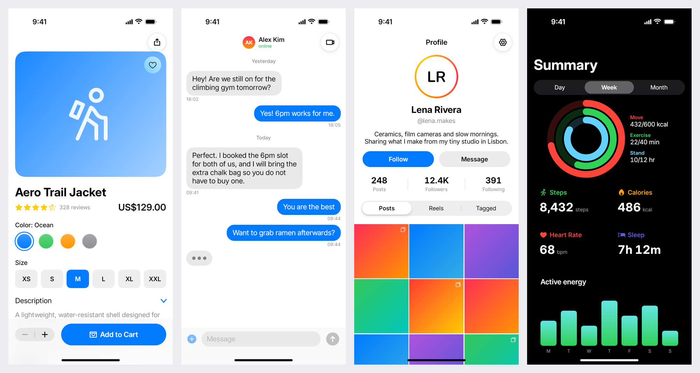

# blitr

See what your SwiftUI code looks like without Xcode or a simulator. Point it at a Swift file or an Xcode
project and it writes PNGs of your previews, on Linux or on a Mac.

```
blitr render ProfileView.swift --scheme both --out-dir shots
```




Every image above was rendered from the unmodified SwiftUI files in [`Tests/Corpus`](Tests/Corpus).

## What it is for

- **Coding agents in the cloud.** A Claude Code session on Linux can change a screen and look at the result
  before it opens a pull request.
- **CI.** Render every preview on each pull request and attach the images, or diff them against the last run.
- **Machines without a simulator.** A first render takes under two seconds, a repeat about a third of a second.
- **One component at a time.** Render a single view at its own size, or cut one section out of a full screen,
  while you iterate on it.
- **Every state of a screen.** Light and dark, every Dynamic Type size, another language and region, a fixed
  date, time zone and location, landscape, the open and folded iPhone Duo, tvOS focus states.
- **Real photos without the network.** Record an app's remote images once with `--image-cache`, and every
  later render, in CI or a cloud session, shows them offline.
- **Store and marketing images.** Device frames drawn around the screen, or your own frame artwork.
- **Accessibility review.** The accessibility tree as JSON, tap targets outlined, and the problems found in it
  (small targets, missing labels, truncated text).

It draws iOS 18, 26 and 27 (Liquid Glass), tvOS and watchOS, on every current iPhone, iPad, Apple TV and Apple
Watch. It is a reimplementation of SwiftUI drawn with Skia, so it gets close to a simulator screenshot, not
pixel for pixel: see [Accuracy](#accuracy).

## Install

On a Mac with Xcode (or the Command Line Tools):

```
brew install sam-apostel/blitr/blitr
```

From npm, on a Mac or on Linux. The first run downloads the release for your platform, and on Linux the Swift
toolchain it needs (about 1 GB, once, into `~/.cache/blitr`):

```
npm install -g @apostel/blitr   # or: npx @apostel/blitr render MyView.swift -o shot.png
```

On Linux, for a setup script (installs into `/opt/blitr`, with the Swift toolchain in `/opt/swift`):

```
curl -fsSL https://github.com/Sam-Apostel/blitr/releases/latest/download/install.sh | bash
```

In a container, with everything inside:

```
docker run --rm -v "$PWD:/work" ghcr.io/sam-apostel/blitr render MyView.swift -o shot.png
```

`blitr doctor` checks the installation. On Linux, renders compile your code with the exact Swift version
blitr was built with, which every route above installs for you; on a Mac, Xcode's own compiler is used.

### From source

```
git clone https://github.com/Sam-Apostel/blitr && cd blitr
brew install harfbuzz pkg-config        # on Linux: apt-get install libharfbuzz-dev
scripts/bootstrap.sh                    # pinned Skia, HarfBuzz and open fonts into Vendor/, checksummed
swift build -c release
"$(swift build -c release --show-bin-path)/blitr" doctor
```

`scripts/make-dist.sh` builds a relocatable release tarball, and the `Dockerfile` an image built from source.

## Everyday use

```
blitr list Sources/Profile/ProfileView.swift                  # the previews in a file
blitr render Sources/Profile/ProfileView.swift --all --scheme both --out-dir shots
blitr render Sources/Profile/Avatar.swift --view 'Avatar(user: .sample)' --layout fit
blitr render App/HomeView.swift --device iphone-17-pro-max --dynamic-type accessibility2
blitr render App/HomeView.swift --crop trip-card --crop-padding 12
```

What gets rendered, first match wins: `--view "<expression>"`, a `#Preview` (`--preview <index|name>`, or
`--all`), a `PreviewProvider`, widgets from their timeline provider, or the first `WindowGroup` of an `@main`
app. A file inside an Xcode project, an XcodeGen `project.yml` or a Swift package is built with its target and
local packages, asset catalogs, fonts and string catalogs ([docs/PROJECTS.md](docs/PROJECTS.md)).

## Command line

```
blitr render <file-or-dir>... [options]    render previews to PNG
blitr list <file-or-dir>...                the previews found
blitr check <file | --target Name>         compile only, and summarise what is unsupported
blitr devices                              device profiles
blitr compare <reference> <candidate>      diff screenshots: heatmaps, element frame deltas
blitr doctor | version
```

`blitr render --help` lists every option. The ones you will use most:

**What and where**

| Option | |
|---|---|
| `-o file.png`, `--out-dir dir` | Output; `--out-dir` when several images are written. |
| `--preview <n\|name>`, `--all`, `--view "<expr>"` | Which preview, every one, or a view expression. |
| `--device <id>` | `iphone-16` by default; `blitr devices` lists them all, and names are forgiving. |
| `--orientation portrait\|landscape\|landscape-right` | Also set by `#Preview(traits: .landscapeLeft)`. |
| `--ios 18\|26\|27` | Which design to draw (default 27). Apple TV and Watch devices imply `--platform tvos\|watchos`. |
| `--layout fit`, `--width`, `--height` | Just the view at its own size, or at a size you propose. |
| `--crop <part>`, `--crop-padding <pt>` | One part of a full screen: a view's `.accessibilityIdentifier`, a label, or `x,y,w,h` in points. |
| `--frame`, `--frame-dir <dir>` | Device hardware around the screen, drawn or from your own `<device-id>.png` images. |
| `--rounded-corners`, `--show-island`, `--no-chrome` | Display corners, the Dynamic Island, no status bar. |

**Device state**

| Option | |
|---|---|
| `--scheme light\|dark\|both` | Appearance. |
| `--dynamic-type <size>` | `xSmall` to `xxxLarge`, `accessibility1` to `accessibility5`. |
| `--locale nl_BE` | Language and region: strings, number, currency and date formats (default `en_US`). A region override such as `en_US@rg=bezzzz` (English with Belgian formats) works too. |
| `--time-zone Europe/Brussels`, `--date 2026-06-01T09:41:00Z` | Time zone (default UTC) and the moment timelines show. |
| `--location 51.05,3.72` | Location access granted, and this position reported. Without it, access is not determined. |
| `--allow-network` | Let the code load data and remote images. Renders are offline by default. |
| `--image-cache <dir>` | Keep the images the code downloads, and show them in later offline renders: record once with `--allow-network`, then render anywhere. |
| `--env KEY=VALUE`, `--arg <value>` | Environment variables and launch arguments for the app, read through `ProcessInfo`: reach debug routes and states without writing a preview. |
| `--map-tiles <dir>` | Draw maps on map tiles you supply (`z/x/y.png`). |
| `--assets <dir>`, `--fonts <dir>` | Extra images, asset catalogs and fonts. |

**Interaction and outputs**

| Option | |
|---|---|
| `--steps "tap Settings; type Name \"Sam\"; snapshot"` | Tap, type, scroll and swipe before the frame is taken ([docs/INTERACTION.md](docs/INTERACTION.md)). |
| `--animated out.gif`, `--filmstrip out.png`, `--frames dir` | The steps as an animation, a strip, or one PNG each. |
| `--full-content out.png` | A whole scroll view in one tall image. |
| `--press down,select`, `--focus <element>`, `--focus-map f.json` | tvOS remote presses and the focus engine ([docs/FOCUS.md](docs/FOCUS.md)). |
| `--accessibility-tree f.json`, `--tap-targets f.png` | The accessibility tree with its problems, and tap targets outlined. |
| `--json` | One JSON line per image: path, size and warnings. |

Anything the renderer cannot draw faithfully (an unmapped symbol, a missing asset, a UIKit view it does not
know) is drawn as a placeholder and reported on a `warning:` line, never silently wrong.

## Using it from a coding agent

Paste this into your coding agent, and it installs blitr in its own environment (local or cloud), adds the skill
to the project and renders a screen to check:

```
Set up blitr for this project, following https://github.com/Sam-Apostel/blitr/blob/main/docs/agent-setup.md
```

Or add this to the project's `CLAUDE.md` (or `AGENTS.md`) so the agent checks its SwiftUI work:

```markdown
## Seeing SwiftUI changes
After changing SwiftUI code, render it with `blitr` and look at the PNGs before you finish:
- `blitr render <file> --all --scheme both --out-dir /tmp/shots` renders every preview, light and dark.
- `--view "MyView(model: .sample)" --layout fit` renders one component; `--crop <identifier>` one part of a screen.
- Check `--device iphone-se` and `--dynamic-type accessibility3` for truncation, and `--locale` for other languages.
- Every `warning:` line names something that was not drawn faithfully.
Keep the images out of the repository.
```

[`integrations/claude-skill/blitr`](integrations/claude-skill/blitr) is a Claude Code
skill with the same instructions in more depth: copy it into the project's `.claude/skills/`. In a cloud
environment, install it in the setup script with the `install.sh` line under [Install](#install).

## Fonts and symbols

The bundled open fonts stand in for Apple's: Inter for SF Pro (laid out with SF Pro's widths, so lines break
where SF breaks them to within about 1%), Nunito, Source Serif 4 and JetBrains Mono, and Phosphor icons for
about 2,200 SF Symbols. A Mac uses its own SF Pro, SF Mono, New York and Apple Color Emoji automatically.

For Apple's fonts and the real SF Symbols, download the fonts from Apple (this accepts Apple's licence, which
allows mock-ups of software for Apple platforms), then map the symbol names once on a Mac:

```
scripts/fetch-apple-fonts.sh --accept-apple-font-license
scripts/mac/generate-symbol-map.sh
```

`--open-fonts` forces the open set, which makes renders on Linux and on a Mac match, apart from emoji (a Mac
always draws Apple Color Emoji).

## Accuracy

Spacing, bar heights, list rows, controls, Liquid Glass and the tvOS and watchOS chrome are measured against
simulator screenshots, and each measured constant says so in the code. Against the simulator, most iOS 27
screens differ in under 1.5% of their pixels, every tvOS screen in under 1.4%, and the watch screens in under
0.9%. Most of what remains is glyph and symbol shapes when the open fonts are used.

Known limits:

- It is not Apple's renderer: subtle effects such as vibrancy and some materials are fitted models.
- Right-to-left text is not supported.
- Gestures and live animation have no effect on a still frame; scripted steps and animated captures cover
  interaction.
- About 40 Apple frameworks beyond SwiftUI are provided ([docs/FRAMEWORKS.md](docs/FRAMEWORKS.md)). Others,
  such as Charts, SwiftData and WebKit, are reported as missing. UIKit views inside SwiftUI are drawn when they
  draw themselves or are built from standard UIKit views; other UIKit controls show a labelled placeholder.
- On Linux, the Swift toolchain must be the exact version the tool was built with (the installers fetch it); on a
  Mac, Xcode with that Swift version or newer.

## How it works

Your sources are compiled with the regular Swift compiler against a module named `SwiftUI` that this project
implements, with its own layout, text shaping (HarfBuzz) and drawing (Skia). The program that comes out
resolves the view tree, runs `onAppear` and `.task` on a virtual clock, lays it out and writes the PNG.
[docs/ARCHITECTURE.md](docs/ARCHITECTURE.md) has the details, [docs/ROADMAP.md](docs/ROADMAP.md) what is next,
and [docs/REFERENCE.md](docs/REFERENCE.md) how it is calibrated against the simulator.

## Licences

blitr is released under the [MIT licence](LICENSE). It builds on, and `scripts/bootstrap.sh` downloads,
third-party components under their own licences: Skia (BSD-3-Clause, prebuilt by the SkiaSharp project, MIT),
HarfBuzz (MIT), Inter, Nunito, Source Serif 4, JetBrains Mono and Noto Color Emoji (SIL OFL 1.1), and Phosphor
Icons (MIT, compiled into `Sources/SwiftUI/Symbols`). SwiftUI, SF Pro and SF Symbols are trademarks of Apple
Inc.; this project is not affiliated with Apple and contains no Apple code, fonts or artwork. Apple's fonts are
downloaded only on request, from Apple, under Apple's terms.
