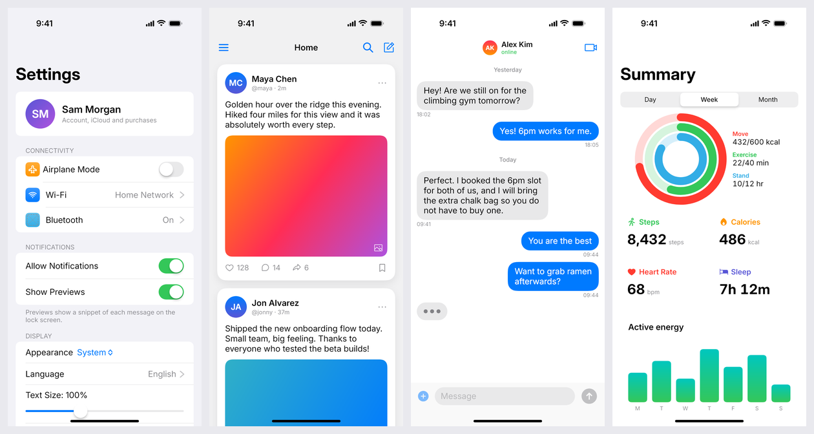

# blitr

See what your SwiftUI code looks like without Xcode's simulator. Point it at a Swift file or an Xcode project
and it writes PNGs of your previews, on Linux or on a Mac.

```
npx blitr render ProfileView.swift --scheme both --out-dir shots
```



## Install

```
npm install -g blitr
```

The package is a small launcher. Its first run downloads the blitr release for your platform into
`~/.cache/blitr` (`BLITR_HOME` moves it), checked against its published checksum.

- **macOS:** your code is compiled with Xcode's Swift compiler (or the Command Line Tools': `xcode-select
  --install`), of the Swift version the release was built with or newer. `blitr doctor` checks it.
- **Linux (x64, arm64):** blitr needs the exact Swift version it was built with, and downloads it from
  swift.org (about 1 GB, once) for Ubuntu 20.04 to 24.04, Debian 12, RHEL 9 and Amazon Linux 2. Elsewhere,
  install that toolchain yourself and set `BLITR_SWIFT_DIR` to it. The toolchain needs the system packages
  swift.org lists for your distribution.

Set `BLITR_SKIP_DOWNLOAD=1` to skip the download at install time; the first run does it instead.

## Use

```
blitr list Sources/Profile/ProfileView.swift
blitr render Sources/Profile/ProfileView.swift --all --scheme both --out-dir shots
blitr render Sources/Profile/Avatar.swift --view 'Avatar(user: .sample)' --layout fit
blitr render App/HomeView.swift --device iphone-17-pro-max --dynamic-type accessibility2
blitr render --help
```

Devices, locales, dates, locations, dark mode, Dynamic Type, scripted taps, tvOS focus and the accessibility
tree are all options. The full documentation is at
[github.com/Sam-Apostel/blitr](https://github.com/Sam-Apostel/blitr).
